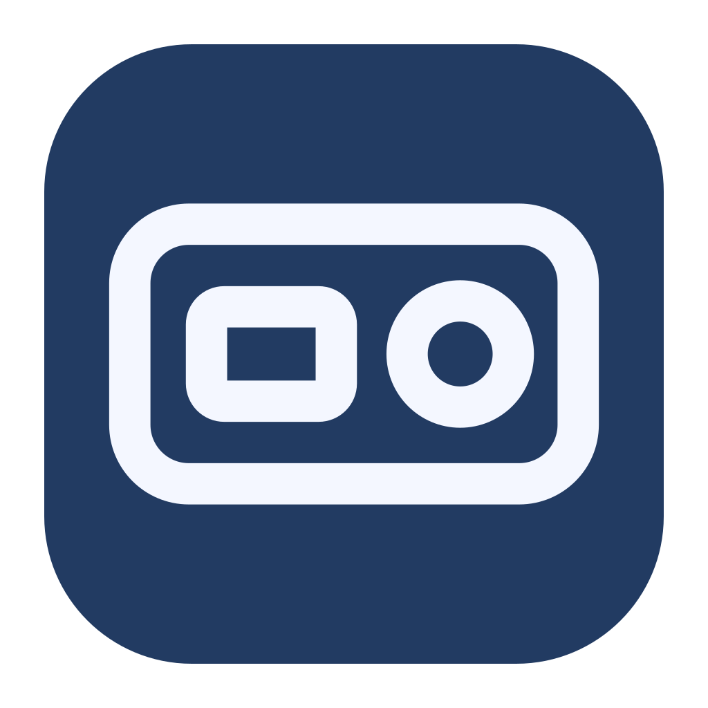

# MUSILAND MD30 for macOS



乐之邦 MUSILAND MD30 的独立 macOS USB 音频驱动和菜单栏面板，已在 Apple Silicon Mac 和 MD30 实机上测试。

当前版本为 **0.1.11**。Finder 应用图标和顶部菜单栏图标均由仓库内的 SVG 生成。

- 通过 Core Audio 播放双声道 PCM，支持 44.1、48、88.2、96、176.4 和 192 kHz。
- 面板只驻留顶部菜单栏，可切换采样率、播放左右声道测试音，并显示独占状态。Mac 识别到 MD30 时自动启动面板，断电或拔线后自动关闭。
- 兼容的播放器可通过 Core Audio 独占输出 16、24 或 32 位整数 PCM。驱动保留播放器提交的有效样本位，验证范围到 USB 提交。

## 构建和安装

需要 Xcode、CMake 3.28 或更新版本，以及 Python 3。构建会获取固定版本的 [libASPL](https://github.com/gavv/libASPL)。

```sh
cmake -S . -B build/release -DCMAKE_BUILD_TYPE=Release
cmake --build build/release
scripts/package.sh
```

打开 `build/publish/MD30-macOS.pkg` 并授权安装。把 MD30 切到 USB 输入，在 macOS 声音设置中选择 **MUSILAND MD30**。点击右上角 **MD30** 打开面板，面板内的「退出」可关闭应用。

安装包会重新加载 Core Audio，并在新驱动就绪后刷新控制中心和当前用户的 Chrome 音频子进程。正在播放的音频会短暂中断，Chrome 窗口和标签页会保留。

## 独占播放与排查

在面板启用「允许播放器使用整数独占」，再在支持整数独占的播放器中选择 MD30。面板会区分整数和浮点输出。普通浏览器播放使用系统混音。

已测试的 MD30 可在断电重开后直接播放。面板的启动代码工具是可选的诊断入口，原厂 Windows 驱动和固件由用户自行从 [乐之邦原厂页面](https://www-old.musiland.cn/index.php/Download/show/id/73) 获取。

[开发踩坑、解决办法和测试命令](docs/troubleshooting.md)
